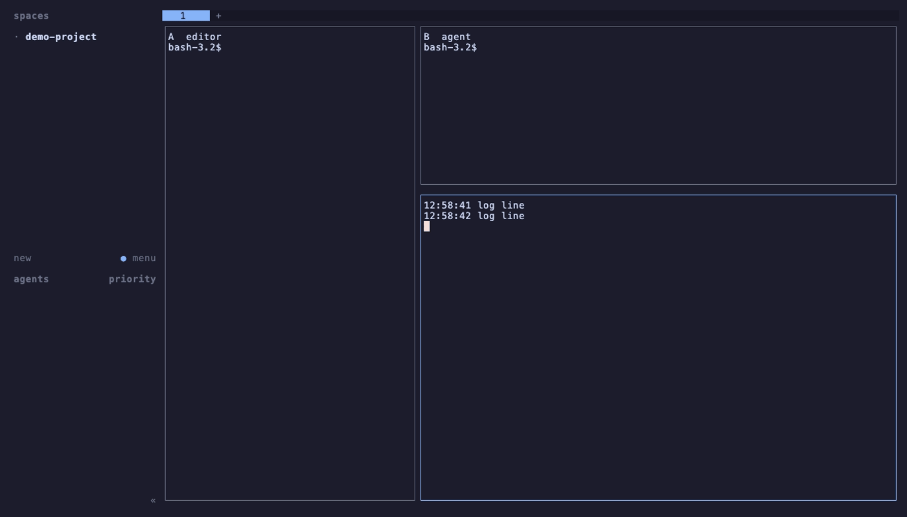

# Reficus — herdr plugin

Automatically resizes [herdr](https://herdr.dev) panes so the pane you are
working in is large and the rest step back — without you ever touching a
resize key.



```
 focus on left                      focus on bottom-right
┌──────────────────┬────────┐      ┌────────┬──────────────────┐
│                  │   B    │      │        │        B         │
│        A         ├────────┤  →   │   A    ├──────────────────┤
│     (focused)    │   C    │      │        │   C (focused)    │
│                  │        │      │        │                  │
└──────────────────┴────────┘      └────────┴──────────────────┘
```

- **Plugin id:** `reficus`
- **Requires:** herdr ≥ 0.8.2, `python3` ≥ 3.9 on herdr's `PATH`, macOS or Linux
- **Dependencies:** none (Python standard library only)
- **Settings popup:** `prefix+shift+f`

---

## Contents

1. [Why use it](#why-use-it)
2. [Install](#install)
3. [Quick start](#quick-start)
4. [How it works](#how-it-works)
5. [Strategies](#strategies)
6. [Settings popup](#settings-popup)
7. [Settings reference](#settings-reference)
8. [Profiles](#profiles)
9. [Process rules](#process-rules)
10. [Agent-aware sizing](#agent-aware-sizing)
11. [Narrow-screen fallback](#narrow-screen-fallback)
12. [Scope](#scope)
13. [Manual resizes](#manual-resizes)
14. [Actions, CLI and keybindings](#actions-cli-and-keybindings)
15. [Recipes](#recipes)
16. [Files](#files)
17. [Security](#security)
18. [Troubleshooting](#troubleshooting)
19. [Limitations](#limitations)
20. [Uninstall](#uninstall)
21. [Contributing](#contributing)
22. [License](#license)

---

## Why use it

Tiled layouts force a trade-off: either every pane is too small to work in, or
you keep resizing by hand (`prefix+r`, arrows, repeat) every time you move.
herdr is built for running many coding agents side by side, which makes this
worse — four agents plus a shell and a log tail on one screen leaves each pane
a sliver.

Reficus removes the trade-off:

- **The pane you are in is always readable.** Agent TUIs (Claude Code, Codex,
  …) wrap badly or break below ~80 columns; the focused one gets the space.
- **Everything else stays visible.** Unlike zoom (`prefix+z`), the other panes
  don't disappear — you still see agents working, logs scrolling, tests
  finishing.
- **Your eye is pulled to what needs you.** With agent-aware sizing a
  `blocked` agent (waiting for your input) grows on its own, and idle/finished
  ones shrink.
- **Zero keystrokes.** Focus moves with your normal `prefix+h/j/k/l`, mouse
  clicks or `prefix+tab`; sizing follows.
- **Context-aware.** Different sizing for nvim vs. a log tail, a laptop screen
  vs. an external monitor, a "coding" vs. a "review" session.
- **It gets out of the way when you want it to.** Choose what a manual resize
  means — temporary, kept, or "hands off this tab" — and turning the plugin
  off restores your original layout.
- **Your own modes.** Tune any setting and save the result as a named
  profile; switch between them from the popup or with a key.

If you have ever used golden-ratio / focus modes in i3, tmux, Neovim
(`focus.nvim`) or VS Code, this is the same idea for herdr.

---

## Install

```bash
herdr plugin install 81zi/reficus
herdr plugin list            # check it is enabled and has no warnings
```

herdr shows a preview of the manifest and the commands it will run before
installing. Update later with `herdr plugin update reficus`.

On the next herdr server start, the plugin's startup hook adds the default
keybinding (`prefix+shift+f` → settings popup) to `~/.config/herdr/config.toml`
once, unless that key is taken. Until then, open the popup with:

```bash
herdr plugin action invoke reficus.settings
```

After that, change keys in the popup's **Keybindings** section — see
[Keybindings](#keybindings).

> herdr runs plugin commands without a shell, so `python3` must be on the
> `PATH` the herdr **server** was started with. Check with `which python3`.

### From source

```bash
git clone https://github.com/81zi/reficus.git
herdr plugin link ./reficus
```

### Upgrading from an earlier plugin id

Earlier versions used the plugin id `81zi.reficus` (0.4.0) or
`local.reficus` (before 0.4.0). Remove the old one, then install this
version:

```bash
herdr plugin uninstall 81zi.reficus   # or: herdr plugin unlink local.reficus
herdr plugin install 81zi/reficus
```

On first run your settings and per-tab state are copied from the old
config and state directories (the old ones are left in place), and on the
next server start keybindings that call `reficus.*` or
`local.reficus.*` are rewritten to `reficus.*`.

---

## Quick start

1. Split a pane (`prefix+v`) and split again (`prefix+minus`).
2. Move focus around with `prefix+h/j/k/l`. The focused pane grows to 65 %
   of each split it sits in; the others share the rest.
3. Press `prefix+shift+f` to open the settings popup. Change **Active
   profile** to `review` with `→` — the focused pane now takes 80 %.
4. Change *Focused share* to 0.70, then **Save as new profile…** → `mine`.
   You now have your own mode. Press `q` to close.

That is the whole default experience. Everything below is optional tuning.

---

## How it works

herdr layouts are binary trees: every split divides its area between a
**first** and a **second** child by a **ratio** (share of the first child).

On every relevant event the plugin:

1. reads the tab's layout tree (`layout.export`) and terminal area,
2. gathers per-pane facts — agent status and matched process rule,
3. computes a target ratio for **every** split in the tab,
4. writes the ratios with `layout.set_split_ratio` (optionally animated).

It runs on these herdr events:

| Event | Reaction |
|---|---|
| `pane.focused` | after the dwell delay, re-plan the focused pane's tab |
| `pane.created`, `pane.closed` | re-plan the affected tab |
| `pane.agent_status_changed` | re-plan the tab (only when agent weights are not 1.0) |

### The weight model

Each pane gets a **weight**: the focused pane weighs `F`, every other pane
weighs `1` (adjusted by agent status, see below). A subtree's weight along an
axis is:

- **sum** of children when the split runs along that axis (panes side by side
  share the space),
- **max** of children when the split runs across it (stacked panes share the
  same width).

A split's ratio is `weight(first) / (weight(first) + weight(second))`.

`F` is chosen so a plain two-pane split gives the focused pane exactly the
configured share: `F = ratio / (1 − ratio)`, e.g. `0.65 → F ≈ 1.86`.

Example — three columns `A | B | C`, focus on `C`, ratio 0.65:

```
A: 1 / 3.86 ≈ 26 %    B: 1 / 3.86 ≈ 26 %    C: 1.86 / 3.86 ≈ 48 %
```

The focused pane is always the biggest; the others are equal to each other.

After weights, **constraints** are applied per split, in this order:

1. **max caps** (from process rules),
2. **min sizes** (`min_cols` / `min_rows`, rule mins, accordion strips) —
   mins win over caps. If both sides' minimums don't fit, the space is split
   in proportion to the minimums.

Splits are **left unchanged** when the axis is disabled, when you kept them
after a manual resize (`keep` mode), or (in `ancestors` strategy) when the
split doesn't contain the focused pane.

---

## Strategies

Set per profile. Measured on a 186×77 tab with layout `A | (B / C)`:

| Strategy | What it does | Focus on A | Focus on C |
|---|---|---|---|
| `weighted` *(default)* | Weight model above. Focused pane gets `ratio` of each split, others equal. | A 121 cols | A 65, C 65 % of rows |
| `golden` | Like weighted but the focused side always gets 61.8 % (golden ratio), `ratio` is ignored. | A 115 cols | A 71 cols |
| `fixed` | Focused pane gets exactly `fixed_cols` × `fixed_rows` cells (if it fits); others share the rest. | A 120 cols | C 40 rows |
| `accordion` | Focused pane takes everything except thin strips (`accordion_cols` / `accordion_rows`, at least the min sizes) for the others. Zoom that keeps neighbours visible. | A 166, B/C 20 cols | — |
| `ancestors` | Only splits on the path to the focused pane change; every other split keeps whatever ratio it had (e.g. your manual sizing). | — | — |
| `equal` | Everything 50/50. Useful as a "monitor" profile or a one-shot reset. | A 93 cols | 93 / 93 |

Which to pick:

- **weighted** — general purpose.
- **golden** — fixed, aesthetically balanced proportions regardless of profile.
- **fixed** — you want "my editor is always 120 columns" no matter the
  screen size.
- **accordion** — small screens, or deep focus while still seeing activity.
- **ancestors** — you like to hand-tune parts of the layout.
- **equal** — watching many agents at once.

---

## Settings popup

Open with `prefix+shift+f` (or `herdr plugin action invoke reficus.settings`).

```
Reficus settings
tab w1:t3  active

General
  Enabled                      on

Profile
  Active profile               coding  * unsaved changes
  Save to active profile
  Save as new profile…
  Revert unsaved changes
  Delete active profile

Sizing
  Strategy                     weighted
  Focused share                0.70
  ...
Keybindings (enter to set, empty = none)
  Open settings popup          prefix+shift+f
  Toggle on/off                —
  ...
```

| Key | Action |
|---|---|
| `↑` `↓` / `j` `k` | move |
| `←` `→` / `h` `l` | change value (step) |
| `enter` / `space` | toggle, cycle, or type a value / open the rules editor |
| `e` | equalize the current tab now |
| `r` | resume the current tab: clear a pause and any kept manual splits |
| `x` | restore the tab's saved layout and pause it |
| `q` / `esc` | close (or go back from the rules editor) |

Every change is **saved immediately and applied live** — you see the layout
behind the popup move as you adjust. The second line shows the current tab's
state: `active`, `DISABLED`, `PAUSED (r to resume)`, `N split(s) kept from
manual resize` or `narrow zoom`.

Prompts (names, keys, numbers) are typed on the bottom line: `enter` accepts,
`esc` cancels. Confirmations take `y`.

**Rules editor** (enter on *Process rules*): `a` add, `d` delete, `enter`
edit. In a rule, numeric fields can be unset: press `←` past the minimum, or
`enter` and submit an empty value.

---

## Settings reference

Stored in `~/.config/herdr/plugins/config/reficus/config.json`.
Missing keys use the defaults; the file only needs the keys you change.

**Tunables** — the values below down to `idle_weight` are what a
[profile](#profiles) saves. The top-level values are the *working set* the
plugin uses right now.

| Key | Default | Range / values | Meaning |
|---|---|---|---|
| `strategy` | `"weighted"` | see [Strategies](#strategies) | How space is divided. |
| `ratio` | `0.65` | 0.50–0.95 | Focused share of each split it sits in (weighted / accordion / ancestors). |
| `fixed_cols` | `120` | 20–400 | `fixed` strategy: focused pane width. |
| `fixed_rows` | `40` | 5–200 | `fixed` strategy: focused pane height. |
| `min_cols` | `20` | 0–200 | No pane narrower than this (when it fits). |
| `min_rows` | `5` | 0–100 | No pane shorter than this (when it fits). |
| `accordion_cols` | `12` | 1–60 | `accordion`: width of collapsed panes. |
| `accordion_rows` | `3` | 1–30 | `accordion`: height of collapsed panes. |
| `axis` | `"both"` | `both` / `horizontal` / `vertical` | Which splits may change: `horizontal` = side-by-side splits (widths), `vertical` = stacked splits (heights). |
| `dwell_ms` | `120` | 0–1000 | Wait this long after a focus change; if focus moved again, skip. Stops the layout jumping while you cycle panes. `0` = immediate. |
| `animate_frames` | `0` | 0–12 | Slide to the new size in N steps (~12 ms each). `0` = instant. |
| `on_manual_resize` | `"override"` | `override` / `keep` / `pause` | What a resize by hand means — see [Manual resizes](#manual-resizes). |
| `narrow_cols` | `0` | 0–400 | Below this terminal width use `narrow_mode`. `0` = off. |
| `narrow_mode` | `"zoom"` | `zoom` / `equal` | What to do on narrow screens. |
| `agent_boost` | `1.0` | 1.0–4.0 | Weight of an unfocused `blocked` agent pane. `1.0` = off. |
| `idle_weight` | `1.0` | 0.2–1.0 | Weight of an unfocused `idle`/`done` agent pane. `1.0` = off. |

**Global** — not part of profiles:

| Key | Default | Range / values | Meaning |
|---|---|---|---|
| `enabled` | `true` | bool | Master switch. Turning it off restores saved layouts. |
| `profile` | `"coding"` | profile name or `"manual"` | Active profile; `manual` = working set not tied to a profile. |
| `profiles` | see [Profiles](#profiles) | map name → tunables | Saved profiles. |
| `rules` | `[]` | list | [Process rules](#process-rules). |
| `scope_mode` | `"all"` | `all` / `allow` / `deny` | Where the plugin is active. |
| `scope_workspaces` | `[]` | list of ids/labels | Workspaces for `allow`/`deny`. |
| `scope_tabs` | `[]` | list of regexes | Tab labels for `allow`/`deny`. |
| `keybindings` | settings = `prefix+shift+f` | map action → key or `null` | See [Keybindings](#keybindings). |
| `keybindings_initialized` | `false` | bool | Set after the first-run keybinding setup; stops it re-running. |

Example `config.json` (profiles abbreviated — saved profiles hold every
tunable; missing ones are filled from the working set):

```json
{
  "profile": "deep",
  "profiles": {
    "coding":  { "strategy": "weighted",  "ratio": 0.65 },
    "review":  { "strategy": "weighted",  "ratio": 0.8 },
    "monitor": { "strategy": "equal",     "ratio": 0.5 },
    "deep":    { "strategy": "accordion", "ratio": 0.9, "animate_frames": 6 }
  },
  "strategy": "accordion",
  "ratio": 0.9,
  "min_cols": 30,
  "dwell_ms": 150,
  "animate_frames": 6,
  "narrow_cols": 140,
  "agent_boost": 1.8,
  "idle_weight": 0.6,
  "rules": [
    { "match": "^claude$", "min_cols": 82 },
    { "match": "nvim", "ratio": 0.75 },
    { "match": "tail|docker logs|journalctl", "max_rows": 12 }
  ]
}
```

The config is re-read on every event, so edits by hand take effect on the
next focus change — no reload needed.

---

## Profiles

A profile is a saved copy of **every tunable** (sizing, behaviour, agent
weights — everything in the first table of the
[Settings reference](#settings-reference)). Rules, scope and
keybindings are global and not part of profiles.

Built-in profiles (all other tunables at their defaults):

| Profile | Strategy | Ratio | Use |
|---|---|---|---|
| `coding` | weighted | 0.65 | default |
| `review` | weighted | 0.80 | reading diffs / one agent at a time |
| `monitor` | equal | — | watching many agents |

**How it works:**

- Selecting a profile copies its values into the working set.
- Change anything afterwards and the popup shows
  `coding  * unsaved changes`. Your changes are live immediately — you
  don't have to save to use them.
- **Save to active profile** — overwrite the profile with the current values.
- **Save as new profile…** — type a name; creates (or overwrites) a profile
  and makes it active. This is how you create your own mode.
- **Revert unsaved changes** — reload the active profile's saved values.
- **Delete active profile** — removes it; the current values stay as
  `manual`. At least one profile must remain.
- Switching away from a profile with unsaved changes asks for confirmation.

**Manual mode.** The last entry in the profile list is `manual`: the working
set is not tied to any profile, so you can experiment freely without a
"modified" marker. Pick **Save as new profile…** when you like the result.

`cycle-profile` (action or key) steps through saved profiles only, and
shows a toast with the new name.

---

## Process rules

Rules adjust sizing per pane based on what runs in it. For each pane the
plugin collects:

- the herdr agent name (e.g. `claude`),
- each foreground process's `name`, `argv0` and full command line.

The **first** rule whose `match` regex is found in any of those wins.

| Field | Meaning |
|---|---|
| `match` | Python regex, searched (not anchored). Use `^…$` for exact. |
| `ratio` | Focused share to use **when this pane is focused** (weighted/accordion/ancestors). |
| `min_cols`, `min_rows` | Minimum size for this pane (raises the global min). |
| `max_cols`, `max_rows` | Maximum size for this pane. |

Unset fields (`null`) are ignored. Examples:

```json
{ "match": "^claude$",              "min_cols": 82 }
{ "match": "nvim|hx",               "ratio": 0.75 }
{ "match": "lazygit",               "ratio": 0.85 }
{ "match": "tail -f|docker logs",   "max_rows": 12 }
```

> Rules cost one `pane.process_info` call per pane per event, so they are only
> evaluated when at least one rule exists.

---

## Agent-aware sizing

herdr tracks each agent's status: `working`, `blocked`, `idle`, `done`,
`unknown`. When enabled, unfocused panes get weights by status:

| Status | Weight |
|---|---|
| `blocked` | `agent_boost` (e.g. 1.8) |
| `idle`, `done` | `idle_weight` (e.g. 0.6) |
| anything else | 1.0 |

The plugin also re-plans whenever an agent's status changes, so a pane grows
the moment its agent asks for input — even if you are focused elsewhere — and
shrinks back once it is working again.

Applies to `weighted`, `accordion` and `ancestors`. Turn off by setting both
values to `1.0` (the default); then status events are ignored entirely.

---

## Narrow-screen fallback

Set `narrow_cols` (e.g. `140`) to change behaviour when the tab is narrower
than that — e.g. laptop screen vs. external monitor.

- **`zoom`** — zoom the focused pane (like `prefix+z`). The zoom follows your
  focus, and is removed automatically once the terminal is wide again.
- **`equal`** — equalize instead of focusing.

Width is checked whenever the plugin runs, so after resizing the terminal the
switch happens on the next focus change. A zoom you set yourself with
`prefix+z` is never undone by the plugin; zoomed tabs are left alone.

---

## Scope

Limit where the plugin works:

| `scope_mode` | Active in… |
|---|---|
| `all` | every tab |
| `allow` | only workspaces listed in `scope_workspaces` **or** tabs whose label matches a regex in `scope_tabs` |
| `deny` | every tab **except** those |

Workspaces match by id (`w1`) or label (`my-project`). Tab patterns
are regexes searched in the tab label (`^agents`, `review`).

```json
{ "scope_mode": "deny", "scope_tabs": ["^logs$", "dashboard"] }
```

The explicit **equalize** action ignores scope.

---

## Manual resizes

The plugin remembers the ratios it last applied to each tab. When it is about
to resize and finds some changed while the pane structure stayed the same,
you resized by hand. Because herdr 0.8.2 doesn't send layout-change events
to plugins, this is noticed on the **next focus change** after your resize.

`on_manual_resize` decides what happens then:

| Mode | Effect | Good for |
|---|---|---|
| `override` *(default)* | Ignore it. Your resize lasts until focus moves, then the plugin sizes the tab as usual. | quick one-off peeks |
| `keep` | Remember **the splits you resized** and never touch those again; all other splits keep adapting. Popup shows `N split(s) kept`. | hand-tuning part of a layout |
| `pause` | Stop resizing **that tab** entirely (toast *"Reficus paused"*). Other tabs keep working. | "hands off this tab" |

Kept splits and pauses last until you **resume** the tab, or until panes are
added/closed in it (the structure changed, so the old split positions no
longer apply).

> Older versions always paused, and the pause only went away when you
> resumed by hand. If a tab "stopped working" after a manual resize, that was
> why. The default is now `override`.

| Action | Effect |
|---|---|
| **resume** (popup `r`) | clear the pause and kept splits, re-apply now |
| **restore** (popup `x`) | put back the layout the tab had before the plugin first touched it, and pause the tab |
| **toggle off** | disable globally and restore every tab whose structure is unchanged |
| **toggle on** | clear all pauses / kept splits and apply to the current tab |

The "before" snapshot is taken the first time the plugin resizes a tab, and
re-taken whenever panes are added, closed or moved.

---

## Actions, CLI and keybindings

All actions are available via CLI, keybinding, or the herdr action list.

| Action id | What it does |
|---|---|
| `reficus.settings` | open the settings popup |
| `reficus.toggle` | enable/disable (disable restores layouts) |
| `reficus.cycle-profile` | switch to the next profile, toast the name |
| `reficus.resume` | resume the current tab |
| `reficus.restore` | restore the current tab's saved layout and pause it |
| `reficus.equalize` | one-shot 50/50 for the current tab |
| `reficus.cleanup` | undo every change and disable, before uninstalling — see [Uninstall](#uninstall) |

```bash
herdr plugin action invoke reficus.toggle
herdr plugin action list --plugin reficus
```

### Keybindings

herdr's own Settings screen (`prefix+s`) can't be extended by plugins, so
Reficus manages its keys from **its** popup → **Keybindings**:

1. Select an action, press `enter`.
2. Type a key — `prefix+shift+z`, `prefix+f`, `f12`, `alt+r` … — and `enter`.
   An empty value removes the binding.
3. The key is checked against herdr's defaults, your `[keys]` overrides,
   your other `[[keys.command]]` entries and Reficus' other bindings. A
   conflict is refused with *"prefix+z is already used by herdr zoom"*.
4. The binding is written to `~/.config/herdr/config.toml` and herdr's config
   is reloaded — it works immediately.

What it writes is a marked block the plugin owns:

```toml
# >>> reficus keybindings (managed by the Reficus plugin: edit them in its popup) >>>
[[keys.command]]
key = "prefix+shift+f"
type = "plugin_action"
command = "reficus.settings"
description = "reficus: open settings popup"
# <<< reficus keybindings <<<
```

- Everything outside the block is left alone. Hand-written
  `[[keys.command]]` entries that call `reficus.*` are moved into it.
- Before each write the old file is copied to
  `~/.config/herdr/config.toml.reficus-backup`; the very first time, it is
  also copied to `config.toml.reficus-original`, which is never overwritten.
  The file is replaced atomically (through a symlink, if it is one). If herdr
  rejects the new config, the previous text is restored and reloaded.
- Don't edit inside the block by hand — the popup rewrites it. Edit
  `keybindings` in `config.json` and reopen the popup instead, or just use
  the popup.
- Unbinding the popup's own key asks for confirmation; afterwards reopen it
  with `herdr plugin action invoke reficus.settings`.
- **First run:** the `[[startup]]` hook (`src/reficus.py ensure-keys`) writes
  the default bindings once, skipping keys that are taken, then sets
  `keybindings_initialized` so it never overrides your later choices.

---

## Recipes

**Agent fleet on a big monitor** — see everything, but the agent that needs
you jumps out:

```json
{ "profile": "monitor", "agent_boost": 2.5, "idle_weight": 0.5,
  "rules": [{ "match": "^claude$", "min_cols": 82 }] }
```

**Editor-centric** — nvim always 120 columns, terminals share the rest:

Popup: *Strategy* → `fixed`, *Fixed cols* → 120, *Fixed rows* → 50, then
**Save as new profile…** → `editor`.

**Laptop + external monitor** — focus layout when docked, zoom on the laptop:

```json
{ "narrow_cols": 150, "narrow_mode": "zoom" }
```

**Calm and smooth** — no jumping while cycling, gentle slide:

```json
{ "dwell_ms": 200, "animate_frames": 6 }
```

**Only for agent tabs**:

```json
{ "scope_mode": "allow", "scope_tabs": ["^agents", "^claude"] }
```

---

## Files

```
reficus/
  herdr-plugin.toml   manifest: startup + event hooks, actions, popup pane
  src/
    reficus.py        entry point; dispatches hook/action commands
    core.py           reads herdr state, applies ratios, manual-resize modes
    engine.py         pure layout maths (weights, strategies, constraints)
    settings.py       config defaults, migration, profiles, state + locks
    settings_tui.py   curses settings popup
    keys.py           keybinding block in herdr's config.toml
    herdr_api.py      tiny socket client for the herdr API
  tests/              unit tests (python3 -m unittest discover -s tests)
  docs/               demo.gif and the VHS script that records it
  README.md           this file
```

| Path | Content |
|---|---|
| `~/.config/herdr/plugins/config/reficus/config.json` | your settings |
| `~/.local/state/herdr/plugins/reficus/state.json` (`$HERDR_PLUGIN_STATE_DIR`) | runtime state: per-tab snapshots, last applied ratios, pauses, kept splits |
| `~/.config/herdr/config.toml` (marked block) | Reficus keybindings |
| `~/.config/herdr/config.toml.reficus-backup` | copy of config.toml before the last keybinding change |
| `~/.config/herdr/config.toml.reficus-original` | copy of config.toml before Reficus first changed it |

`herdr plugin config-dir reficus` prints the config directory.
Deleting `state.json` is safe — it resets pauses, kept splits and
snapshots.

`engine.py` has no herdr dependency, so the maths can be tested on plain
dicts:

```python
import engine, settings
P = lambda i: {"type": "pane", "pane_id": i}
S = lambda d, a, b: {"type": "split", "direction": d, "ratio": 0.5, "first": a, "second": b}
cfg = settings.effective(settings.DEFAULTS)
print(engine.Planner(cfg, "C", {}).plan(S("right", P("A"), S("down", P("B"), P("C"))), 200, 60))
# {(): 0.35, (True,): 0.35}
```

---

## Security

herdr does not sandbox or review plugins: Reficus runs as you, with your
permissions. Read `herdr-plugin.toml` and `src/` before installing — herdr
shows the manifest and every command it will run in the install preview.

What Reficus touches:

- **herdr API** — over `$HERDR_SOCKET_PATH`, only for reading panes, tabs
  and layouts, setting split ratios, zoom, opening its own popup, showing
  toasts and reloading config. It never sends input to panes or reads
  their output. Process rules read each pane's agent and foreground process
  name and command line to match against your patterns; these are not
  stored.
- **Files it writes** — its own `config.json` and `state.json`, and the
  marked keybinding block in `~/.config/herdr/config.toml`, with backups
  (see [Files](#files) and [Keybindings](#keybindings)). Nothing is written
  into the plugin directory.
- **Commands it runs** — only `python3` with the scripts in `src/`, started
  by herdr with `-E -s -B` so `PYTHON*` variables and user site-packages
    can't inject code and no bytecode is written next to the scripts. It
  starts no other programs and no background processes.
- **Network** — none. No telemetry, no update checks.
- **Removal** — the `cleanup` action undoes all of the above; see
  [Uninstall](#uninstall).

Report security issues privately through
[GitHub security advisories](https://github.com/81zi/reficus/security/advisories/new)
rather than a public issue.

---

## Troubleshooting

**Nothing resizes.**

1. `herdr plugin list` → plugin `enabled`, no warnings.
2. `herdr plugin log list --plugin reficus` → look for `failed`
   entries and their `stderr`.
3. Open the popup: is it `DISABLED` or `PAUSED`? Is scope excluding the tab?
4. Single-pane and zoomed tabs are intentionally left alone.
5. `python3` not found → herdr server's `PATH` lacks it; restart the server
   from a shell where `which python3` works.

**It stopped resizing one tab (or some splits).** You resized by hand with
`on_manual_resize` set to `pause` (whole tab) or `keep` (those splits). The
popup's second line says which. Press `r` in the popup, or switch the mode
to `override`.

**A keybinding doesn't work.** Open the popup → Keybindings: is it set? Was
it refused for a conflict (status line)? Check
`~/.config/herdr/config.toml` has the marked block, and
`herdr server reload-config` reports no diagnostics.

**Layout jumps while I cycle panes.** Raise `dwell_ms` (150–250).

**A pane won't get smaller/bigger.** Check `min_*`, rule `max_*`, kept splits
(`keep` mode) and `axis`. When constraints can't all fit, minimums win.

**The popup doesn't open.** It can only open from the normal workspace view
(not while herdr's own Settings, copy mode or another popup is open), and
needs room for 78×46 cells — shrink `width` / `height` in
`herdr-plugin.toml` for small terminals.

**Debug a hook by hand** (from a herdr pane, where `HERDR_SOCKET_PATH` is
already set):

```bash
cd /path/to/reficus   # the plugin directory shown by `herdr plugin list`
HERDR_PLUGIN_EVENT=pane.focused \
HERDR_PLUGIN_EVENT_JSON='{"pane_id":"w1:p2"}' \
python3 -E -s -B src/reficus.py hook
```

---

## Limitations

- **Manual resizes are detected late** — on the next focus change, not
  instantly (herdr 0.8.2 doesn't send layout-change events to plugins). A
  terminal resize is likewise picked up on the next focus change.
- **Conflicting caps.** If two max caps can't both fit, the second side loses.
- **One extra Python process per event.** Each event starts a short Python
  process (~40 ms). Negligible in practice; rules add one API call per pane.
- **Keybindings can't live in herdr's own Settings screen**; plugins can't
  extend it. They are set in the Reficus popup and written to config.toml.
- **Conflict checks need Python ≥ 3.11** (`tomllib`) to read your custom
  bindings; on older Python only herdr's defaults are checked.
- macOS and Linux only (Unix socket, `fcntl` locks). Reficus uses the raw
  socket API rather than the `herdr` CLI because the CLI has no command to
  read the split tree or set an absolute split ratio.

---

## Uninstall

```bash
herdr plugin action invoke reficus.cleanup
herdr plugin uninstall reficus        # or `unlink` for a source checkout
```

`herdr plugin uninstall` only unregisters a plugin: by design herdr keeps
its config and state, and plugins get no uninstall hook. So run the
clean-up action first (also in the popup under **Uninstall**, or in herdr's
action list). It:

1. restores every tab's saved layout,
2. removes the Reficus keybindings from `~/.config/herdr/config.toml` and
   reloads it,
3. disables the plugin so no hook runs again,
4. deletes its `config.json` and `state.json` (and copies left under the
   earlier ids `81zi.reficus` / `local.reficus`).

It keeps `config.toml.reficus-original` and `config.toml.reficus-backup`
next to your config as a safety net; delete them by hand if you like.
Changed your mind? `herdr plugin enable reficus` starts again with default
settings.

---

## Contributing

Issues and pull requests are welcome at
[github.com/81zi/reficus](https://github.com/81zi/reficus). The plugin uses
only the Python standard library; please keep it that way. Run the tests
before sending a change:

```bash
python3 -m unittest discover -s tests
```

## License

[MIT](LICENSE)
